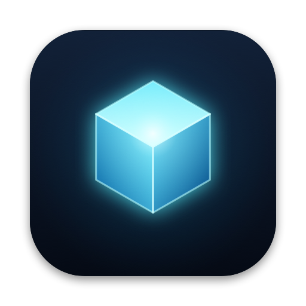
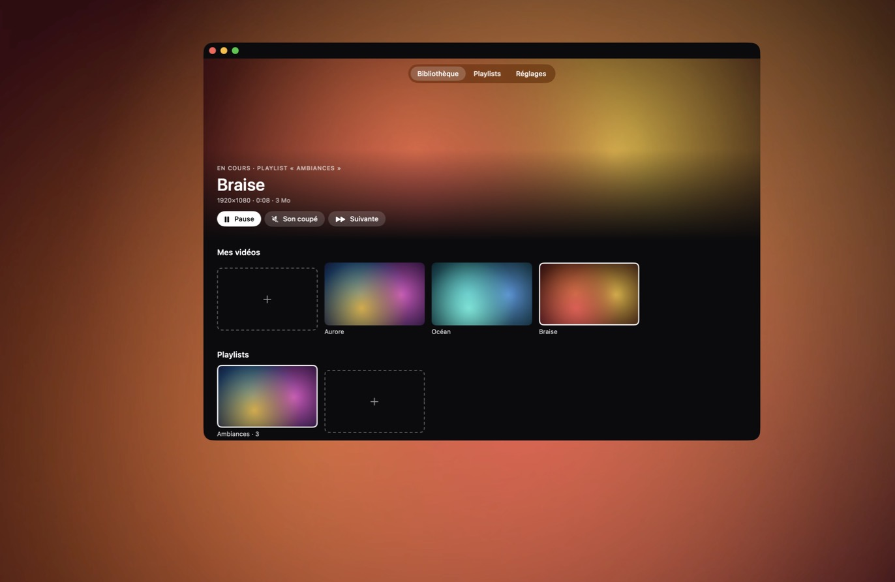
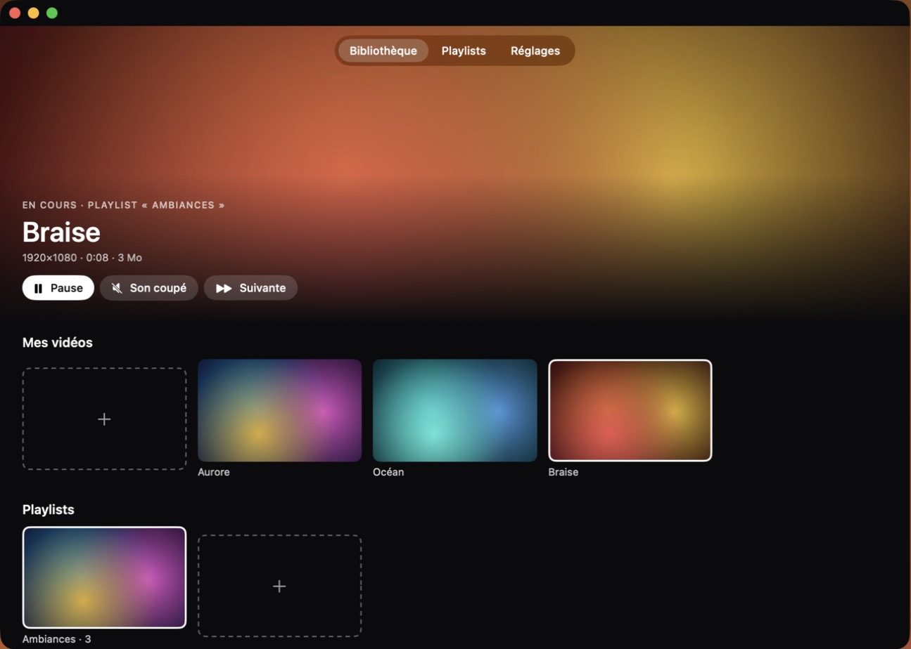
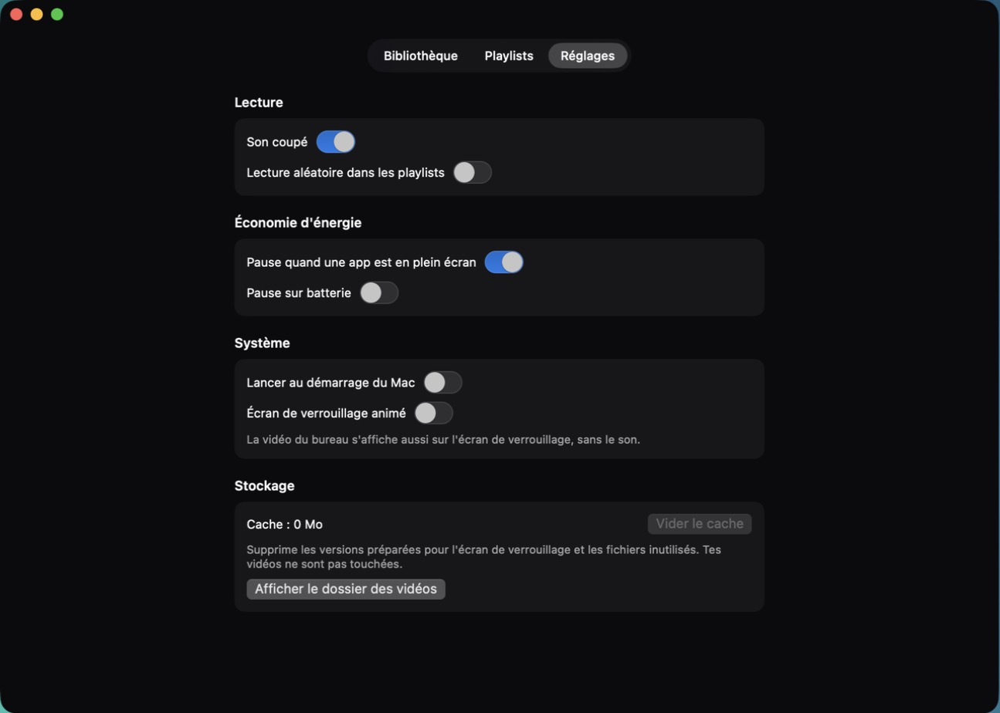
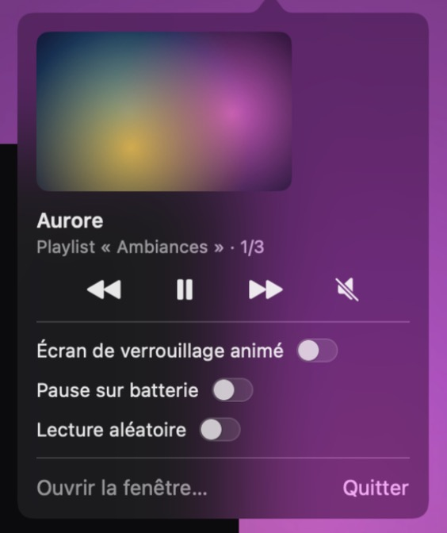

<p align="center">
  
</p>

# Lumen

Fonds d'écran vidéo animés pour macOS, gratuits et légers.

Lumen lit tes propres vidéos en fond d'écran, derrière les icônes du bureau, et peut aussi les afficher sur l'écran de verrouillage. C'est une alternative gratuite aux applications payantes comme Wallper, Wallux, Wallspace ou Backdrop, centrée sur l'essentiel : tes vidéos, en boucle, sans faire chauffer le Mac.



| Bibliothèque | Réglages | Barre des menus |
|---|---|---|
|  |  |  |

## Fonctionnalités

- **Vidéo en fond d'écran** : n'importe quelle vidéo `.mp4`, `.mov` ou `.m4v`, jusqu'en 4K, en boucle derrière les icônes, sur tous les bureaux virtuels.
- **Plusieurs écrans** : la vidéo s'affiche sur tous les écrans branchés, décodée une seule fois.
- **Import par glisser-déposer** ou avec le bouton ＋. Les vidéos sont copiées dans Lumen : déplacer ou supprimer l'original ne casse rien.
- **Playlists** : quand une vidéo se termine, la suivante démarre, puis on revient au début. Lecture aléatoire en option.
- **Son** : les vidéos peuvent jouer leur son, coupé par défaut.
- **Économie d'énergie** : pause automatique quand une app est en plein écran, quand l'écran est en veille ou verrouillé, pendant l'économiseur d'écran et, en option, sur batterie.
- **Écran de verrouillage animé** (macOS 26 et plus, en option) : il suit la vidéo du bureau.
- **Fenêtre principale** façon Wallper, et **menu dans la barre des menus** pour les gestes rapides : pause, son, vidéo suivante.
- **Lancement au démarrage** du Mac.
- **Vider le cache** depuis Réglages › Stockage : supprime les versions préparées pour l'écran de verrouillage et les fichiers inutilisés, sans toucher à tes vidéos.
- **Aperçu au survol** : passe le pointeur sur une vignette pour voir la vidéo bouger, sans le son. Le lecteur n'existe que pendant le survol.
- **Mises à jour** : Lumen vérifie une fois par jour s'il existe une nouvelle version sur GitHub et l'indique dans le menu de la barre des menus. C'est une seule requête anonyme à l'API publique de GitHub, sans aucune donnée envoyée, et elle se désactive dans Réglages.

## Consommation

Mesures sur un MacBook Pro M5 avec des vidéos 4K, fenêtre fermée :

| Vidéo | CPU de Lumen |
|---|---|
| 4K HEVC | ~1,4 % d'un cœur |
| 4K H.264 | ~1,4 % d'un cœur |

Le décodage passe par la puce graphique. Lumen ne tourne que par notifications du système, sans aucune minuterie, et n'empêche jamais l'écran de se mettre en veille. Quand le son est coupé, la piste audio est désactivée pour ne pas être décodée.

## Prérequis

- macOS 15 ou plus récent ; l'écran de verrouillage animé demande macOS 26 ou plus.
- Mac Apple Silicon.
- Les **Command Line Tools** d'Xcode (Swift 6) suffisent, Xcode complet n'est pas nécessaire :

```bash
xcode-select --install
```

## Installation

### Télécharger l'app

1. Télécharge le dernier `Lumen-x.y.z.dmg` dans les [Releases](https://github.com/clepix21/lumen/releases/latest).
2. Ouvre-le et glisse **Lumen** dans **Applications**.
3. Au premier lancement, macOS bloque l'app, car elle n'est pas signée par un développeur Apple. Ouvre **Réglages Système › Confidentialité et sécurité**, puis clique sur **Ouvrir quand même** en face de Lumen.

### Compiler depuis les sources

```bash
git clone https://github.com/clepix21/lumen.git
```

```bash
cd lumen
```

```bash
bash scripts/build-app.sh --install
```

Le script compile Lumen en mode release, assemble `build/Lumen.app`, le signe localement et le copie dans `~/Applications/Lumen.app`. Ouvre-le ensuite depuis le Finder ou Spotlight.

## Utilisation

1. Au premier lancement, la fenêtre s'ouvre : ajoute une vidéo avec ＋ ou glisse-la dans la fenêtre. Elle passe aussitôt en fond d'écran.
2. Clique sur une autre vidéo pour la mettre en fond d'écran.
3. Pour une playlist : ＋ dans la rangée « Playlists », puis clic droit sur une vidéo › « Ajouter à une playlist ». Clique sur la playlist pour la lancer.
4. Fermer la fenêtre ne coupe pas le fond d'écran : Lumen reste dans la barre des menus.

### Écran de verrouillage animé

1. Active « Écran de verrouillage animé » dans le menu ou dans Réglages.
2. Une seule fois : choisis **Lumen** dans **Réglages Système › Fond d'écran**. Si tu utilises plusieurs bureaux virtuels, active aussi « Afficher sur tous les bureaux » : l'écran de verrouillage reprend le fond du bureau sur lequel tu te trouves.
3. Verrouille ton Mac (ctrl-cmd-Q) : la vidéo du bureau s'y affiche, sans le son.

macOS ne propose pas d'interface officielle pour cela. Lumen ajoute une entrée « Lumen » à la liste des fonds d'écran Aerial de macOS, sans toucher aux autres entrées, puis relance le service de fond d'écran du système. Désactiver l'option retire cette entrée proprement. Une mise à jour de macOS pourrait casser cette fonction ; le reste de Lumen continuerait de marcher.

Les vidéos H.264 sont converties une seule fois en HEVC pour l'écran de verrouillage, jamais sur batterie.

## Où sont mes données ?

```
~/Library/Application Support/Lumen/
├── Videos/        copies de tes vidéos
├── Thumbnails/    vignettes
├── LockScreen/    versions HEVC pour l'écran de verrouillage
└── library.json   bibliothèque, playlists et réglages
```

Réglages › « Afficher le dossier des vidéos » ouvre ce dossier dans le Finder.

## Développement

```bash
swift build
```

```bash
swift test
```

Le code est séparé en deux cibles :

- **`LumenCore`** : toute la logique, testée avec Swift Testing (bibliothèque, playlists, règles de pause, import, lecteur, écran de verrouillage).
- **`Lumen`** : l'application (AppKit et SwiftUI), c'est-à-dire la fenêtre du fond d'écran, la surveillance du système et l'interface.

Deux particularités viennent de la compilation sans Xcode :

- `Package.swift` indique explicitement le chemin du plugin de macros de Swift Testing, que SwiftPM oublie parfois avec les seuls Command Line Tools.
- Les vues SwiftUI déclarent leur état avec `State(initialValue:)` plutôt qu'avec `@State`, car le plugin de cette macro n'est livré qu'avec Xcode dans le SDK de macOS 27.

## Licence

Lumen est distribué sous [licence MIT](LICENSE).

## Remerciements

Le fonctionnement de l'écran de verrouillage s'appuie sur l'étude de [LivePaper](https://github.com/Raunik2/LivePaper) (licence MIT).
